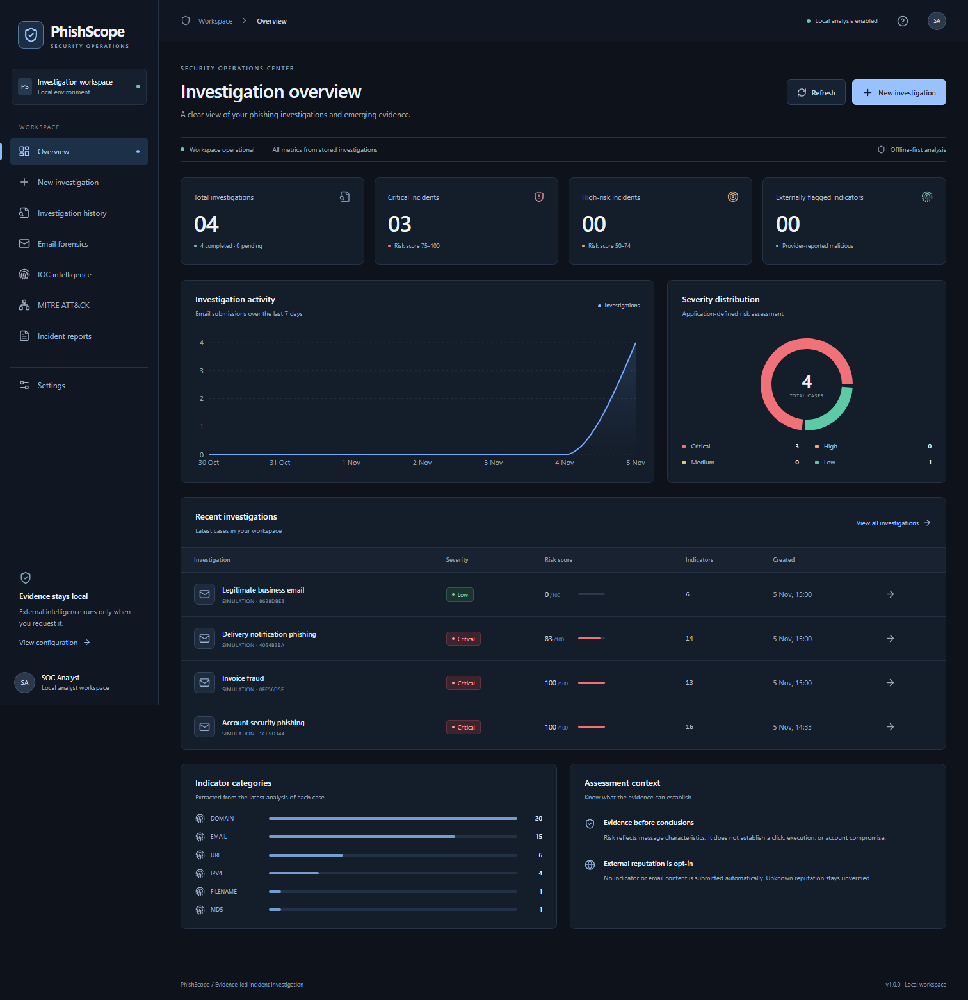
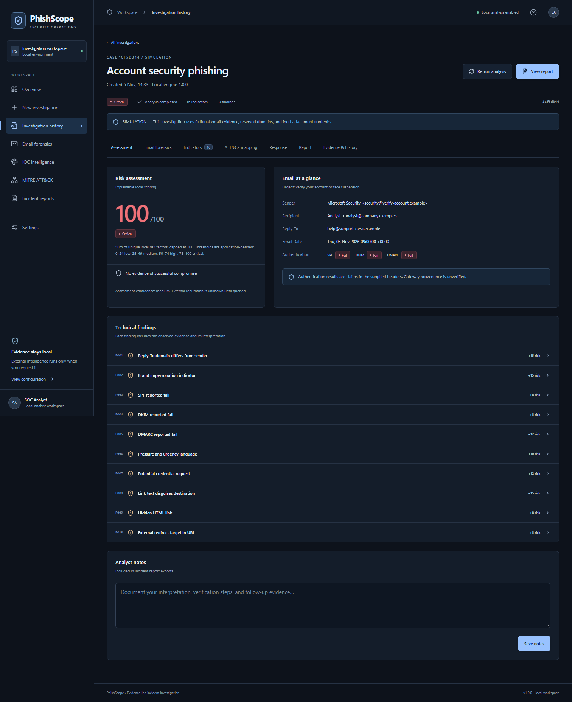
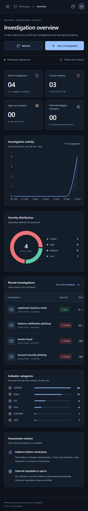

# PhishScope

[](https://github.com/Kushalava917/PhishScope/actions/workflows/ci.yml)

An evidence-led phishing investigation workspace for a single local analyst. Submit an `.eml`/`.txt` file, paste raw email, or select a labelled synthetic case. The application preserves original bytes, analyzes email structure, extracts indicators, explains risk, maps supported ATT&CK hypotheses, and generates incident reports.

## Features

- Eight responsive SOC workspace pages with live database-derived dashboard metrics.
- MIME/header/body parsing, attachment metadata and MD5/SHA-1/SHA-256 calculation, reported SPF/DKIM/DMARC evidence, social engineering and obfuscation checks.
- Deduplicated indicators, evidence locations, search/type filters/sorting, clipboard copy, CSV and JSON export.
- Optional, explicitly initiated VirusTotal, URLScan, AbuseIPDB and Google Safe Browsing lookups. Offline operation requires no keys.
- Explainable 0–100 risk factors; suspected ATT&CK delivery mappings remain distinct from unverified execution hypotheses.
- Conditional response recommendations, analyst notes, immutable original evidence, retained analysis revisions, typed deletion confirmation.
- Preview and export PDF (cover + 18 sections, classification, tables, page numbers), Markdown and JSON reports. Export history includes revision IDs and content hashes.
- Three phishing simulations and a benign control, all reserved-domain and inert.

## Architecture and important paths

| Layer | Implementation |
| --- | --- |
| UI | Next.js App Router, TypeScript, React, Tailwind CSS 4, owned shadcn-style Button with Radix Slot, Lucide, Recharts |
| API | Python 3.14, FastAPI, Pydantic, SQLAlchemy 2 |
| Storage | SQLite with WAL and foreign keys; Alembic schema migration at startup |
| Analysis | Python email parser, BeautifulSoup text extraction, bundled offline public-suffix data via tldextract |
| Reports | ReportLab PDF; structured JSON; Markdown |
| Tests | Pytest, Vitest + Testing Library, Playwright Chromium |

`backend/analysis.py` owns forensic rules and risk/mapping logic. `backend/main.py` exposes the API. `backend/db.py` defines the six application tables. `backend/intelligence.py` isolates outbound providers. `backend/reports.py` renders records. `frontend/src/components/workspace.tsx` implements the workspace pages. `frontend/src/app/globals.css` defines the responsive design tokens. `scripts/` contains Windows setup/start/test commands. See [ARCHITECTURE.md](ARCHITECTURE.md), [SECURITY.md](SECURITY.md), [TESTING.md](TESTING.md), and [verified local results](docs/VERIFICATION.md).

## Windows PowerShell installation

Prerequisites: **Python 3.14** and **Node.js 24 LTS** with npm on PATH. The resolved versions are committed in `backend/requirements.lock.txt` and `frontend/package-lock.json`. A working internet connection is required to install dependencies; analysis then works offline.

```powershell
git clone https://github.com/Kushalava917/PhishScope.git
Set-Location PhishScope
powershell -ExecutionPolicy Bypass -File .\scripts\setup.ps1
powershell -ExecutionPolicy Bypass -File .\scripts\start.ps1
```

Open **http://127.0.0.1:3000**. Ctrl+C in the start terminal shuts down the API. Backend logs are written under `logs/` (ignored by Git).

Production build and local run:

```powershell
powershell -ExecutionPolicy Bypass -File .\scripts\start.ps1 -Production
```

Or run services in two terminals, starting from the repository root:

```powershell
# Terminal 1
.\.venv\Scripts\python.exe -m uvicorn backend.main:app --host 127.0.0.1 --port 8000
```

```powershell
# Terminal 2
Set-Location frontend
npm run build
npm run start
```

The frontend proxies `/api/*` to `http://127.0.0.1:8000`. API docs: http://127.0.0.1:8000/docs. Both local services bind to loopback. Webpack is selected deliberately because Turbopack worker startup failed in the delivered Windows environment. Cloning a private repository requires an authorized GitHub login.

## Linux / macOS installation

With Python 3.14 and Node.js 24 installed:

```bash
git clone https://github.com/Kushalava917/PhishScope.git
cd PhishScope
python3.14 -m venv .venv
.venv/bin/python -m pip install -r backend/requirements.lock.txt
cp .env.example .env
cd frontend
npm ci
npm run build
cd ..
.venv/bin/python -m uvicorn backend.main:app --host 127.0.0.1 --port 8000
```

In a second terminal, run `cd PhishScope/frontend` and `npm run start`. The GitHub Actions workflow checks backend tests, frontend tests, TypeScript, the production build, and Chromium workflows on Ubuntu using synthetic evidence only.

## First run

The database starts empty; no fabricated metrics are displayed. Click **Load demonstration cases** on Overview, or choose **New investigation → Demonstration**. Seeding is idempotent per synthetic scenario. Imported samples remain clearly labelled; provider lookups for these cases are blocked.

Investigations are analyzed synchronously and recorded as completed after successful analysis. A failed validation is shown immediately and does not create a partial record. There is no background queue; pending is a real status count, normally zero.

## Configuration and integrations

Copy `.env.example` to `.env` in the repository root. Backend commands must run from that root. API keys are configured only on the backend:

| Provider | Environment variable | Behavior |
| --- | --- | --- |
| VirusTotal | `VIRUSTOTAL_API_KEY` | Existing domain/IP/hash/URL reports; no submissions |
| URLScan.io | `URLSCAN_API_KEY` | Searches existing records; no scan submissions |
| AbuseIPDB | `ABUSEIPDB_API_KEY` | IP reputation check only |
| Google Safe Browsing v4 | `GOOGLE_SAFE_BROWSING_API_KEY` | URL threat-list lookup; review provider terms for intended use |

Restart the API after changing keys. Settings shows configured/not-configured and the last recorded API status; configuration alone does not establish that credentials work. Open an indicator detail, select a provider, explicitly authorize disclosure, then request the lookup. No full email or attachment upload endpoint exists. Reserved/private indicators, simulations, email addresses and query/fragment/user-info-bearing URLs are blocked. Other public indicator values, including URL paths, are disclosed only with consent.

Lookups have a 10-second timeout, no redirect following, status/error handling, a per-provider local rate limit, and a six-hour successful-result cache. Failed or absent lookups remain unverified. Provider reports do not change the static local risk score or claim compromise. Real live provider calls require user-owned keys and were not exercised during delivery; deterministic tests use labelled test doubles.

Preferences (organization, analyst, classification and default input method) are editable in Settings and persisted in SQLite. Keys are never accepted into browser-managed storage or returned by the API.

## Database and migrations

Default database: `data/phishscope.db`, ignored by Git. Alembic migration `0001` runs at startup. Tables: `investigations`, `analysis_revisions`, `indicators`, `intelligence`, `report_exports`, `settings`, plus Alembic's version table. Child records cascade on investigation deletion. Original bytes are base64-encoded in the database alongside a SHA-256 digest; display text is a separate decoded representation.

Back up the `data` directory while both services are stopped (SQLite WAL sidecars must not be discarded during a live copy). Restrict filesystem permissions. Database encryption is not provided. For PostgreSQL, install `psycopg[binary]`, set `DATABASE_URL=postgresql+psycopg://...`, then migrate; the SQLAlchemy model layer is portable, but PostgreSQL runtime behavior has not been validated in this delivery.

## Testing

```powershell
.\scripts\test.ps1
# With both services running:
Set-Location frontend
npx playwright install chromium
npm run test:e2e
```

Backend tests create a disposable SQLite database. Browser tests operate against the running workspace, create labelled test cases and delete their own cases afterward. Use a dedicated database for test-only runs if the workspace has sensitive evidence. See [TESTING.md](TESTING.md) for coverage and verified results.

## Docker

```powershell
docker compose up --build -d
docker compose logs -f
docker compose down
```

Only the frontend is published, on `127.0.0.1:3000`. The backend runs on an internal Compose network. Evidence is stored in the named `phishscope-data` volume; `down` retains it. Containers run as non-root users. `docker compose config --quiet` was validated; actual image builds/runtime require a running Docker Desktop Linux engine, unavailable during delivery.

## Screenshots

Screenshots are generated from actual stored synthetic investigations; numbers reflect those records.





## Example reports

- [Full synthetic phishing incident report](docs/sample-incident-report.pdf)
- [One-page phishing versus legitimate email comparison](output/pdf/phishscope-investigation-comparison.pdf)

The reports and screenshots contain safe synthetic evidence only. The application database, credentials, logs, dependencies, and runtime caches are excluded from Git. A clean clone starts with an empty database; load the demonstration cases in the UI.

To reproduce the one-page comparison, run `.\.venv\Scripts\python.exe scripts\create_comparison_pdf.py` on Windows or `.venv/bin/python scripts/create_comparison_pdf.py` on Linux/macOS. It reads the checked-in synthetic investigation snapshots in `docs/samples/`, so no local evidence database is required.

## Contributing

See [CONTRIBUTING.md](CONTRIBUTING.md) for development and validation expectations. Keep changes evidence-backed, and use synthetic fixtures rather than real email or live malicious infrastructure in issues, pull requests, and tests. This repository does not grant an open-source license; obtain the owner's permission before reuse or redistribution.

## Security and limitations

This is a local, single-user application, with no built-in authentication, tenancy, authorization or encrypted database. Keep loopback defaults; add an authenticated deployment boundary before any shared/network exposure. The platform handles email as hostile evidence: body content is displayed as escaped text; scripts, remote images, attachments and email hyperlinks never execute. API input limits, origin/host restrictions, ORM queries, CSV formula protection and escaped PDF text are implemented and tested.

Heuristics are explainable indicators, not a trained classifier or a guarantee of safety. Authentication results are unverified header claims. No independent DNS authentication, live URL resolution, attachment sandboxing, identity/endpoint telemetry, mailbox remediation, or automatic compromise determination is performed. The ATT&CK explorer is a curated five-technique subset with official links, not the complete ATT&CK catalog. PDF's built-in fonts replace unsupported non-ASCII glyphs with `?`; original evidence and JSON/Markdown retain Unicode. Large workspaces will need API pagination, query optimization, a task queue and additional operational controls. See [SECURITY.md](SECURITY.md) for scope and deployment requirements.
